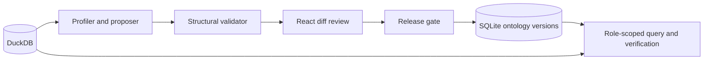

# Ontology Proposer

A local review and release gate for the business definitions an AI analyst uses to answer questions. Profile a DuckDB database, propose metrics and joins, review the diff, and replay saved analyst questions before publishing a new ontology version.

**No API key is required for the investment demo.** A proposed edit swaps market value for historical purchase cost. The SQL runs and the row counts pass. The gate holds publication because the answer for Fund Alpha changes from **$14M to $11M**.

[Watch the investment release gate demo](demo/ontology-investment-gate.mp4)

## Run locally

Requires **Python 3.11+**. Node.js is needed only for the React reviewer.

```sh
python3 -m venv .venv
source .venv/bin/activate
python -m pip install -r requirements.txt
python -m scripts.investment_gate
```

The walkthrough creates a disposable DuckDB database and SQLite review store from the [synthetic investment fixture](examples/investment/csv). It uses the same validator and publication gate as the healthcare workflow.

## What the gate catches

1. **Duplicate positions.** Joining positions to security tags expands six positions into nine rows. The validator rejects the metric because the join counts some positions twice.
2. **A valid sum with the wrong meaning.** The purchase-cost edit still aggregates one row per position, so structural validation passes. The replay compares the current and proposed definitions under each saved plan’s role and reports three changed answers.
3. **A release without acknowledgement.** Attempting to publish returns `Acknowledge the answer changes before publishing`. Published version 1 remains active and still returns $14M for Fund Alpha’s October 31 close.

### Targeted versus full replay

| Replay | Saved plans checked | Changed answers found | Full-replay findings missed |
| --- | ---: | ---: | ---: |
| Targeted | 3 of 4 | 3 | 0 |
| Full | 4 of 4 | 3 | — |

Targeted replay skips the unchanged position count. It compares the executable metric definition and what each role can access. Missing dependency metadata triggers full replay. The table measures checks on this [four-plan fixture](examples/investment/gate-cases.json). Both modes still open role projections in this example, so fewer checks alone cannot establish a wall-clock speedup.

The [Synthea replay comparison](eval/synthea-gate-comparison.json) covers six seeded proposals over 12 saved plans, including cost drift, permission changes, and fan-out. Targeted replay found every finding reported by full replay in those cases. An unreferenced permission grant was blocked before any saved plan ran.

## How it works



- **Profile and propose.** Deterministic profiling collects column statistics and overlapping values as evidence for candidate joins. Claude can use read-only tools to propose definitions. The bundled examples use deterministic proposals.
- **Validate and review.** The validator checks row counts, distinct keys, and nulls. A reviewer approves or rejects each change with the SQL evidence in view.
- **Gate and publish.** The first version uses validation and review. Updates replay saved plans on the same source and bind evidence to the parent, candidate, source, suite, and gate policy. Answer changes require acknowledgement of the current report. Access changes, failed invariants, and replay errors block publication.
- **Answer and verify.** The query agent uses the caller’s visible definitions and a read-only DuckDB projection containing only that role’s columns. Optional verification recomputes the result and withholds disagreements.

[Watch the proposal review demo](demo/ontology-proposer-review-v2.mp4) · [Watch the Synthea release gate demo](demo/ontology-change-gate.mp4)

## Synthea and the review UI

For a keyless UI smoke test, build the reviewer and start the bundled healthcare fixture.

```sh
npm ci --prefix web
npm run build --prefix web
python -m ontology demo
python -m ontology serve
# http://127.0.0.1:8765
```

To run with the official synthetic healthcare CSVs, use the [Synthea sample archive](https://synthetichealth.github.io/downloads.html). The recorded benchmarks use the 18-table, 120-patient snapshot with archive SHA-256 `ce211a05f27022ff1038000243a9291825ceb0107394e399b14c967948c030c3`. Check the archive before comparing results.

```sh
unzip synthea_sample_data_csv_latest.zip -d synthea-csv
python -m ontology --db synthea.duckdb load synthea-csv
python -m ontology --db synthea.duckdb --store synthea.sqlite propose --synthea-reference
python -m ontology --store synthea.sqlite serve
```

Approve the valid reference changes and reject `inflated_encounter_claim_cost` in batch 1, then publish. Run the release comparison with `python -m ontology --db synthea.duckdb gate-compare`, or use `PYTHON=.venv/bin/python sh scripts/check-gate.sh synthea.duckdb` for the keyless gate check.

## Evaluation

### Offline regression benchmark

| Configuration | Synthea correct | Wrong answers returned |
| --- | ---: | ---: |
| Schema only | 24 / 32 | 8 |
| Schema + verification | 24 / 32 | 0 |
| Ontology | 32 / 32 | 0 |
| Ontology + verification | 32 / 32 | 0 |

The [offline report](eval/synthea-offline-baseline.json) measures a curated ontology and deterministic planners. The schema baseline deliberately reproduces a join-grain error. Withheld answers count as incorrect. Live Claude accuracy remains unmeasured.

### Held-out Claude benchmark

The [24 frozen questions](eval/synthea-holdout.json) split evenly between questions covered by the current metric grammar and stretch cases such as distinct counts and compound filters. Both arms use the same analyst-visible data and model. The report records wrong answers, abstentions, and correct and incorrect answers withheld by verification.

For a live run, create a key in the [Claude Console](https://platform.claude.com/settings/keys) and put it in the git-ignored root `.env` as `ANTHROPIC_API_KEY`, along with `ANTHROPIC_MODEL` set to your model ID. The live run can make up to 72 billable model calls.

```sh
python -m ontology --db synthea.duckdb --store synthea.sqlite eval --holdout --check-gold

set -a
. ./.env
set +a
python -m ontology --db synthea.duckdb --store synthea.sqlite eval \
  --holdout --live --output eval/synthea-holdout-live.json
```

## Failure cases and boundaries

- **Join ambiguity.** Value overlap can suggest a relationship with no business meaning. Proposed joins still require review. In Synthea, a join to claims transactions grew 6,762 encounters into 171,480 rows despite complete matching and zero measure nulls.
- **Verification scope.** Two execution paths can agree on an incorrect business definition. The gate adds a comparison against the published definition for registered saved plans. Coverage depends on the suite.
- **Metric scope.** Structured plans support scalar SUM, AVG, and COUNT, an optional equality filter per saved plan, and direct equality joins from the base table. The held-out benchmark makes the limits of that grammar visible.
- **Role boundary.** The CLI role represents an already-authenticated caller in an integrating app. The proposer and review UI are trusted local operator surfaces. Tests cover rejection of a restricted filter and physical omission of restricted columns from the analyst projection.

## Verification and project notes

```sh
python -m pytest -q
python -m scripts.investment_gate
```

The test suite runs against local fixtures without Claude credentials or a Synthea download. This is an AI-assisted portfolio project. The [spec](SPEC.md), [build conventions](CLAUDE.md), and [decision log](DECISIONS.md) document the implementation and tradeoffs.
