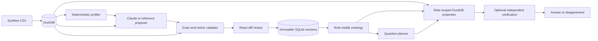

# Ontology Proposer

Ontology Proposer profiles synthetic healthcare tables in DuckDB, proposes a semantic layer, and gives a human the evidence to approve it one change at a time. The validator catches one failure that can survive ordinary SQL tests: a correct-looking total calculated after a one-to-many join.

AI-assisted portfolio project. The repository history starts with the spec, then records the tests and implementation slices. See [SPEC.md](SPEC.md), [CLAUDE.md](CLAUDE.md), and [DECISIONS.md](DECISIONS.md).



Watch the [1:51 recorded walkthrough](demo/ontology-proposer-walkthrough.mp4) for profiling, proposal review, publication, and analyst verification on the local DuckDB healthcare fixture. The recording includes narration and English captions.

## Run locally

Requires Python 3.11+ and Node.js for the optional React reviewer.

```sh
python3 -m venv .venv
source .venv/bin/activate
python -m pip install -r requirements.txt
npm ci --prefix web
npm run build --prefix web
python -m pytest -q
```

### Official Synthea data

Download the current 100-patient CSV archive from [Synthea Downloads](https://synthetichealth.github.io/downloads.html). The sample used here contains 18 tables and 120 actual patient records. Its archive SHA-256 was `ce211a05f27022ff1038000243a9291825ceb0107394e399b14c967948c030c3`. The public latest archive can change.

```sh
unzip synthea_sample_data_csv_latest.zip -d synthea-csv
python -m ontology --db synthea.duckdb load synthea-csv
python -m ontology --db synthea.duckdb profile
python -m ontology --db synthea.duckdb --store synthea.sqlite propose --synthea-reference
python -m ontology --store synthea.sqlite serve
```

Open [the local review screen](http://127.0.0.1:8765/?batch=1). Approve the validated reference changes and reject `inflated_encounter_claim_cost`, then publish. `review BATCH`, `decide CHANGE approve|reject`, and `publish BATCH` expose the same workflow in the CLI. For an entirely self-contained smoke test, run `python -m ontology demo` and `python -m ontology serve`. The fixture's valid cost metric is named `claim_cost`.

```sh
python -m ontology --db synthea.duckdb --store synthea.sqlite query \
  '{"metric":"encounter_claim_cost"}' --role analyst --verify
python -m ontology --db synthea.duckdb --store synthea.sqlite eval \
  --synthea --baseline eval/synthea-offline-baseline.json
```

### Run the live Claude benchmark

Create a workspace-scoped API key in the [Claude Console](https://platform.claude.com/settings/keys). In the repository root, create a local `.env` file with these two assignments.

```sh
ANTHROPIC_API_KEY=your_key_here
ANTHROPIC_MODEL=claude-sonnet-4-6
```

Replace the placeholder and adjust the model ID if needed. Git ignores `.env`. In the same terminal, load it and run the benchmark against the published Synthea ontology.

```sh
set -a
. ./.env
set +a
python -m ontology --db synthea.duckdb --store synthea.sqlite eval \
  --synthea --live --output eval/synthea-live.json
```

The four configurations can make up to 160 billable model calls. The run prints progress by configuration and writes the report after all four finish. Both live arms use the configured model and share the same analyst-scoped data. Run `propose` without an adapter flag to generate a separate Claude-authored proposal for review. Use `query --live` for individual natural-language queries.

## Evaluation

See the [Synthea questions](eval/synthea-questions.json), [fixture questions](eval/questions.json), and case-level JSON reports in [eval](eval). Each question has a separately specified gold SQL query. Accuracy counts withheld answers as incorrect. Wrong returned answers and coverage distinguish a confident error from a disagreement. Use `--output` to save a report and `--baseline` to report IDs that went from correct to incorrect.

| Configuration | Synthea correct | Synthea wrong returned | Fixture correct | Fixture wrong returned |
| --- | ---: | ---: | ---: | ---: |
| Schema only | 24/32 (75%) | 8 | 29/32 (90.6%) | 3 |
| Schema + verification | 24/32 (75%) | 0 | 29/32 (90.6%) | 0 |
| Ontology | 32/32 (100%) | 0 | 32/32 (100%) | 0 |
| Ontology + verification | 32/32 (100%) | 0 | 32/32 (100%) | 0 |

Offline scores exercise a curated ontology and a deterministic planner. The schema-only adapter deliberately reproduces a claim-grain error. This is a regression benchmark for validation and verification. Live Claude accuracy is unmeasured.

## Failure cases

- **Fan-out.** Joining Synthea encounters to claim transactions by appointment ID produced 171,480 joined rows for 6,762 encounters. The validator rejected the proposed sum even though every encounter matched and the measure had zero nulls. The verified schema baseline withheld the bad answer.
- **Ambiguous relationships.** Value overlap can identify convincing but coincidental joins. Inferred relationships remain candidates. The reviewer decides whether a relationship has the business meaning the model assigns to it.
- **Authorization.** A test passes a prompt asking for the restricted fixture field and stubs the model returning a malicious filter plan. The executor rejects the filter, and the analyst database's catalog contains only the projected columns. The review UI and proposer are trusted local operator surfaces. The CLI role flag represents an already-authenticated caller in an integrating application.
- **Metric scope.** Scalar SUM, AVG, and COUNT accept optional equality filters and direct equality joins from the base table. Approved joins must preserve base grain for metric verification. The verifier can detect a join discrepancy, but both paths can agree on the wrong business definition. SQLite versions freeze ontology objects and review decisions. The separately managed source database can change between runs.
